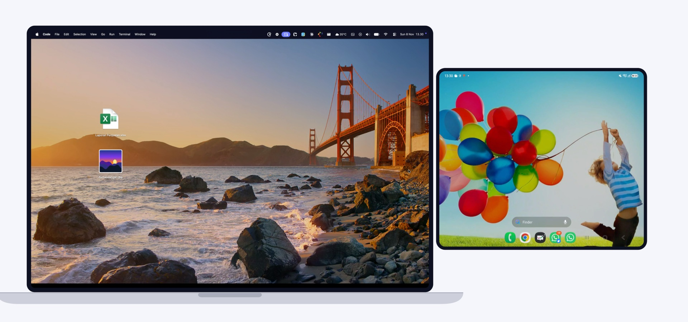

# Cursoe

**One cursor for your Mac and your Android phone or tablet.**

Push the cursor past the edge of your Mac screen and it continues on your Android device. You keep using your
Mac's trackpad and keyboard. There is no screen mirroring: your phone or tablet keeps showing its own screen and
runs its own apps.

> **Status:** v1.0, experimental. Tested on a MacBook Pro (Apple Silicon) with a Galaxy Z Fold6.
> The apps' interface is currently in **Indonesian**; this guide shows the Indonesian labels with their meaning.

## Features

- **Cross the screen edge in both directions.** The cursor appears at the matching height. <kbd>⌘</kbd><kbd>⌥</kbd><kbd>T</kbd> also switches.
- **Trackpad gestures.** Click, long press, drag, two-finger scroll, pinch to zoom, and a three-finger swipe for
  recent apps.
- **Mac keyboard on Android.** Type with your Mac keyboard, including shortcuts: Esc = Back, ⌘H = Home,
  ⌘⇥ = recent apps.
- **Clipboard sync.** Copy on one device, paste on the other. Text and images.
- **Drag and drop files.** Drag a file from Finder to the screen edge to send it to Android, or drag a photo from
  the Android gallery to the Mac.
- **Area screenshots.** Press ⌘⇧S on the Mac to capture part of the Android screen.
- **USB cable, hotspot or Wi-Fi.**
- **Private.** Your devices connect directly to each other. No account, no cloud. Pairing uses a 6-digit PIN and
  everything is encrypted.

## Requirements

| | |
|---|---|
| Mac | Apple Silicon (M1 or later), macOS 14 Sonoma or later |
| Android | Android 8.0 or later, phone or tablet (Android 11 or later recommended) |
| Connection | The Mac connected to the phone's hotspot, both on the same Wi-Fi network, or a USB cable |

## Installation

### Step 1: Download

Download both files from the [latest release](https://github.com/fajarspace/cursoe/releases/latest):

- `Cursoe-<version>.dmg` for your Mac
- `Cursoe-<version>.apk` for your Android device. You can download it directly on the device, or copy it over.

### Step 2: Install on your Mac

1. Open the `.dmg` file and drag **Cursoe** into the **Applications** folder.
2. Open Cursoe from Applications. Cursoe is not notarized by Apple yet, so macOS blocks it the first time:
   1. Open **System Settings › Privacy & Security**.
   2. Scroll down to the message about Cursoe and click **Open Anyway**, then confirm.
3. The Cursoe icon appears in the menu bar. Cursoe has no window; everything is in this menu.
4. **Allow Accessibility.** macOS asks for it on first launch. Open **System Settings › Privacy & Security ›
   Accessibility** and turn on **Cursoe**. Cursoe needs this to move your input to Android. Once it is on, the menu
   item "⚠︎ Beri izin Aksesibilitas…" (grant Accessibility) disappears.
5. **Allow Local Network** access when asked, so the Mac can find your Android device.
6. Optional: turn on **Pengaturan › Buka saat login** (Settings › Open at login) in the menu, and allow
   notifications for incoming files.

### Step 3: Install on your Android device

1. Open the `.apk` file on the device. If asked, allow your browser or file manager to install unknown apps, then
   tap **Install**.
2. Open **Cursoe** and allow what it asks for:
   - **Nearby devices / local network**, so the Mac can find the device;
   - **Notifications**, to show the pairing PIN and the connection status;
   - **Photos and videos: Allow all**, so you can drag photos to the Mac.
3. **Turn on the accessibility service.** In the setup panel, tap **Aktifkan** (enable) next to Aksesibilitas, then
   turn on **Cursoe — kursor Mac** and confirm with **Allow**. On Samsung devices it is under
   *Accessibility › Installed apps*. You only need to do this once.
   - **Is the switch greyed out ("Restricted setting")?** Android 13 and later restrict apps installed from a
     browser. Open *Settings › Apps › Cursoe*, tap **⋮** in the top-right corner, choose
     **Allow restricted settings**, and try again.
4. **Turn on Cursoe Keyboard.** Tap **Aktifkan** next to Cursoe Keyboard and turn it on. It does not need to be your
   default keyboard: Cursoe switches to it automatically while you type from the Mac.
5. Optional: add the **Cursoe** tile to Quick Settings (pull down the notification shade, tap ✎, and drag the tile
   in) to turn Cursoe on and off quickly.

### Step 4: Connect and pair

1. **Connect both devices to the same network.** For the lowest latency, turn on the hotspot on your phone and
   connect the Mac to it. The same Wi-Fi network also works. For a USB cable, see [Connection](docs/connection.md).
2. Make sure Cursoe is on in the Android app (the large power button).
3. The Mac finds the device automatically, and the device shows a **6-digit PIN**.
4. Type the PIN in the dialog that appears on the Mac.

That's it. Later connections happen automatically, without a PIN.

## Getting started

- **Move to Android:** push the cursor past the right edge of the Mac screen. If your device is on the left, change
  it in the menu under **Posisi HP › Kiri** (device position › left).
- **Move back to the Mac:** push the cursor past the edge of the Android screen that faces the Mac.
- **Switch anytime:** press **⌘⌥T**. In an emergency, press **Esc three times**: the cursor always returns to the
  Mac. It also returns automatically when the connection drops, the Android screen turns off, or the Mac sleeps.
- **Send a file:** drag it from Finder to the screen edge and drop it on the blurred zone that appears.

See the [usage guide](docs/usage.md) for every gesture, keyboard shortcut and setting.

## Updating

Download the new release and install it over the old one: drag the new Cursoe into Applications (replace the old
one) and open the new `.apk` on the device. Your pairing and settings are kept.

## Uninstalling

- **Mac:** choose **Keluar** (quit) in the Cursoe menu, then move Cursoe from Applications to the Trash. You can also
  remove it from *System Settings › Privacy & Security › Accessibility*.
- **Android:** uninstall Cursoe like any other app.

## Good to know

- **Banking apps:** some banking apps refuse to open while an accessibility service from outside the Play Store is
  turned on. Turn off Cursoe in *Settings › Accessibility* while you use them, then tap **Aktifkan** in the Cursoe
  app afterwards.
- **No hover on Android:** Android has no mouse hover for accessibility input, so tooltips do not appear.
- Having trouble? See [Troubleshooting](docs/troubleshooting.md).

## Privacy

Cursoe works entirely on your own devices. It has no account, no server and no analytics. The Android
accessibility service only draws the cursor and performs the taps, gestures and keys you send from your Mac; it does
not read your screen. Screenshots are taken only when you press ⌘⇧S. More details are in
[Architecture](docs/architecture.md#security-model).

## License

Cursoe is open source under the [MIT License](LICENSE). Contributions are welcome; see
[CONTRIBUTING.md](CONTRIBUTING.md).
